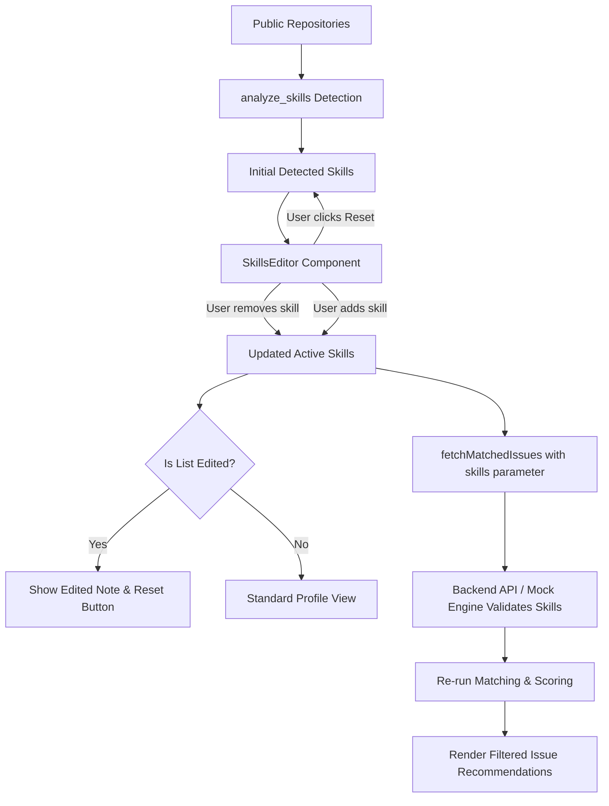

# Custom Skills & Interactive Matching Documentation

## Overview

Automatic skill detection infers a developer's technical profile from their public GitHub repositories. However, this detection can sometimes include legacy technologies the user no longer wishes to receive recommendations for, or miss technologies the user is actively exploring or learned elsewhere.

The **Custom Skills Matching** feature allows developers to dynamically edit their active technical profile directly on the dashboard by removing detected skills or adding new ones. The matching engine immediately re-runs using the customized skills list.

---

## Key Features

1. **Removable Skill Chips (`<SkillsEditor />`)**:
   - Each active skill is displayed as an accessible chip with its tech icon and an explicit remove (`×`) button.
   - User-added skills (coursework, private work, college tools) appear clearly distinguished from repository-detected ones with an **"added by you"** badge and purple styling.
   - Clicking remove eliminates that skill from the active matching set.

2. **Add Skill Input & Known Skills Suggestions**:
   - Input field allowing users to type and add any technology (e.g., `Rust`, `Go`, `Docker`, `React Native`).
   - Interactive autocomplete suggestions from the known skill list (`KNOWN_SKILL_SUGGESTIONS`) displayed via HTML datalist and quick-add suggestion pills.
   - Validates skill names:
     - 1–50 alphanumeric characters and permitted symbols (`+`, `#`, `.`, `-`, spaces).
     - Rejects empty, whitespace-only, or invalid strings.
     - Prevents duplicates (case-insensitively).

3. **Browser Persistence (`localStorage`)**:
   - User-added and customized skills are automatically stored in the browser under `osm_custom_skills_<username>` via `customSkillsStorage.ts`.
   - Stored skills persist across page refreshes and re-analysis.
   - Resetting restores detected skills and clears local storage.

4. **Distinction from Issue Filter Panel**:
   - Unlike the issue filter dropdowns (which restrict search results post-fetch), adding skills dynamically expands the developer's skill profile, sending them to the matching engine to surface new opportunities.

5. **Edited Notice**:
   - When the active skill list differs from the originally detected repository skills, a visible notice is displayed:
     `✏️ Skill list edited by user: Issue recommendations have been re-run with your customized skill profile.`

6. **Reset Button**:
   - When customized, a "Reset to detected skills" action restores the original repository-detected skills, clears the edited note, and re-runs matching.

7. **Backend Explicit Skills Parameter & Validation**:
   - `/api/matching/users/{username}/issues` accepts an optional `skills` query parameter (`list[str]` or comma-separated).
   - Validates each skill using `is_valid_skill`, returning `400 Bad Request` on invalid input.
   - When supplied, filters issues and scores recommendations strictly against the explicit skills list.

---

## Architecture Flow

---

## Acceptance Criteria Checklist

- [x] **Add skills input with suggestions from known skill list**: Implemented in `SkillsEditor.tsx` with `KNOWN_SKILL_SUGGESTIONS`, datalist, and quick-add pills.
- [x] **Added skills appear marked as "added by you" next to detected ones**: Rendered with dedicated `added by you` badges and distinct styling.
- [x] **Duplicates handled**: Case-insensitive deduplication and clear validation alerts.
- [x] **Removable**: Each chip includes an accessible remove (`×`) button.
- [x] **Stored in the browser**: Persisted per username in browser `localStorage` via `customSkillsStorage.ts`.
- [x] **Included in the object sent to the matching endpoint**: Passed as `skills` query parameter to `/api/matching/users/{username}/issues`.
- [x] **Distinct from filter panel**: Expands the skill profile and matching queries rather than restricting search result views.
- [x] **A reset button restores the detected list**: Restores detected skills and clears browser storage.
