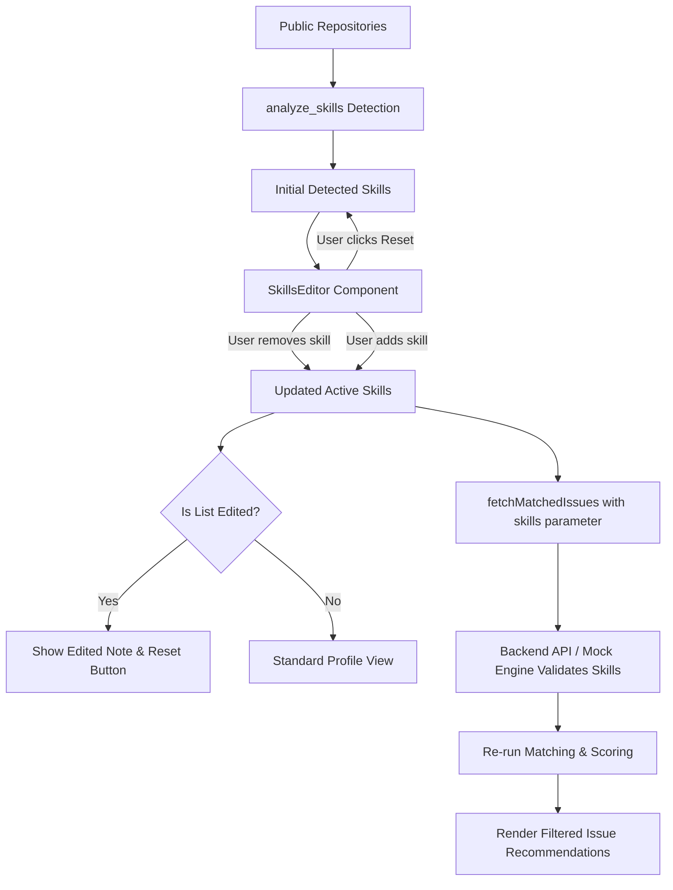

# Custom Skills & Interactive Matching Documentation

## Overview

Automatic skill detection infers a developer's technical profile from their public GitHub repositories. However, this detection can sometimes include legacy technologies the user no longer wishes to receive recommendations for, or miss technologies the user is actively exploring or learned elsewhere.

The **Custom Skills Matching** feature allows developers to dynamically edit their active technical profile directly on the dashboard by removing detected skills or adding new ones. The matching engine immediately re-runs using the customized skills list.

---

## Key Features

1. **Removable Skill Chips (`<SkillsEditor />`)**:
   - Each active skill is displayed as an accessible chip with its tech icon and an explicit remove (`×`) button.
   - Clicking remove eliminates that skill from the active matching set.

2. **Add Skill Input**:
   - Input field allowing users to type and add any technology (e.g., `Rust`, `Go`, `Docker`, `React Native`).
   - Validates skill names:
     - 1–50 alphanumeric characters and permitted symbols (`+`, `#`, `.`, `-`, spaces).
     - Rejects empty, whitespace-only, or malicious strings.
     - Prevents duplicates (case-insensitively).

3. **Edited Notice**:
   - When the active skill list differs from the originally detected repository skills, a visible notice is displayed:
     `✏️ Skill list edited by user: Issue recommendations have been re-run with your customized skill profile.`

4. **Reset Button**:
   - When customized, a "Reset to detected skills" action restores the original repository-detected skills, clears the edited note, and re-runs matching.

5. **Backend Explicit Skills Parameter & Validation**:
   - `/api/matching/users/{username}/issues` accepts an optional `skills` query parameter (`list[str]` or comma-separated).
   - Validates each skill using `is_valid_skill`, returning `400 Bad Request` on invalid input.
   - When supplied, filters issues and scores recommendations strictly against the explicit skills list.

---

## Architecture Flow

---

## Acceptance Criteria Checklist

- [x] **Removing a skill removes its issues from the results**: Verified in `customSkillsMatching.test.ts`.
- [x] **Added skills are used by the matcher**: Verified in `customSkillsMatching.test.ts`.
- [x] **A reset button restores the detected list**: Verified in `SkillsEditor.test.tsx` and `customSkillsMatching.test.ts`.
- [x] **The backend accepts an explicit skills parameter and validates it**: Implemented in `backend/app/api/routes/matching.py` and `backend/app/utils/validation.py`, tested in `backend/tests/test_explicit_skills_matching.py`.
- [x] **Show detected skills as removable chips with an Add skill input**: Implemented in `SkillsEditor.tsx`.
- [x] **Re-run matching with the edited skill list**: Implemented in `page.tsx` and `apiClient.ts`.
- [x] **Show a note that the list was edited by the user**: Displayed in `SkillsEditor.tsx` when `isEdited` is true.
