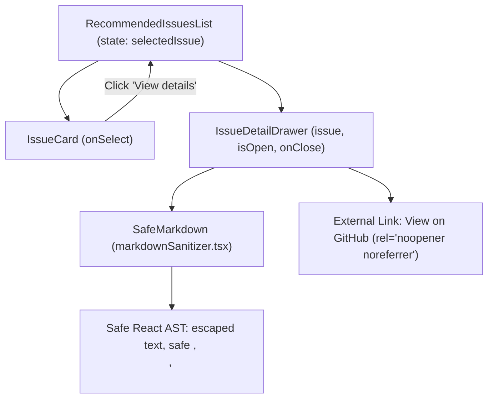

# Issue Detail Drawer with Safely Rendered Markdown

## Overview

The **Issue Detail Drawer** (`frontend/components/IssueDetailDrawer.tsx`) delivers an accessible, sliding detail drawer that displays comprehensive information for any recommended open-source issue, including safely rendered Markdown for the issue description, labels, comment counts, author metadata, match insights, and a direct link to GitHub.

It was introduced in response to **Issue #340** to help contributors inspect issue requirements, reproduction steps, code snippets, and acceptance criteria without needing to leave OpenSourceMate or open multiple external browser tabs.

---

## Key Features

1. **Slide-Over Detail Drawer**:
   - Slides smoothly from the right side of the screen over an accessible dimmed backdrop.
   - Preserves application state and position in the recommendations feed.
   - Supports light and dark mode themes.

2. **Zero-Dependency Safe Markdown Parser & Sanitizer** (`frontend/utils/markdownSanitizer.tsx`):
   - **XSS Protection**: Complete defense against malicious payloads (e.g. `<script>`, `<iframe onload>`, ``, `javascript:` URLs).
   - **Protocol Allowlist**: Only allows safe link protocols (`http:`, `https:`, `mailto:`, and relative links `#`, `/`). Dangerous schemes such as `javascript:`, `vbscript:`, and `data:` (except safe image data URIs) are neutralized.
   - **Safe Hyperlinks**: Every external link is rendered with `target="_blank"` and `rel="noopener noreferrer"`.
   - **Supported Markdown Elements**:
     - Headings (`#`, `##`, `###`, `####`)
     - Bold (`**text**`, `__text__`), Italic (`*text*`, `_text_`), Strikethrough (`~~text~~`)
     - Inline code (`` `code` ``)
     - Fenced code blocks with language badge headers (```typescript ... ```)
     - Task lists (`- [x] `, `- [ ] `) and standard lists (`- `, `* `, `1. `)
     - Blockquotes (`> text`)
     - Responsive safe images (``) with lazy loading

3. **Long Body Truncation ("Show more" / "Show less")**:
   - When an issue body exceeds `maxBodyLength` (default: 1,000 characters), it is truncated cleanly at the nearest paragraph, newline, or word boundary.
   - Users can toggle between the truncated preview and the full description with the "Show more" / "Show less" button.

4. **Accessibility (a11y)**:
   - Follows W3C WAI-ARIA Modal Dialog guidelines.
   - Uses `role="dialog"`, `aria-modal="true"`, `aria-labelledby="issue-detail-title"`, and `aria-describedby="issue-detail-repo"`.
   - Closes seamlessly on <kbd>Escape</kbd> key press, backdrop click, or close button (`✕`) click.
   - Traps Tab key focus inside the drawer while open and restores focus to the triggering element upon closure.
   - Locks background body scroll while the drawer is open to prevent page drift.

5. **Metadata & Action Bar**:
   - Repository name, issue number, and state (`open` / `closed`).
   - Repository Responsiveness and Friendliness indicators.
   - Match score percentage and recommendation insight.
   - Comment count (`💬 5 comments`).
   - Author metadata (`Opened by @username`).
   - "View on GitHub ↗" primary button and "Close" button.

---

## Architecture & Component Hierarchy



---

## File Reference

- **Component**: [`frontend/components/IssueDetailDrawer.tsx`](file:///E:/OpenSourceMate/frontend/components/IssueDetailDrawer.tsx)
- **Sanitizer & Renderer**: [`frontend/utils/markdownSanitizer.tsx`](file:///E:/OpenSourceMate/frontend/utils/markdownSanitizer.tsx)
- **Parent Container**: [`frontend/components/RecommendedIssuesList.tsx`](file:///E:/OpenSourceMate/frontend/components/RecommendedIssuesList.tsx)
- **Trigger Button**: [`frontend/components/IssueCard.tsx`](file:///E:/OpenSourceMate/frontend/components/IssueCard.tsx)
- **Mock Dataset**: [`frontend/data/mockIssues.ts`](file:///E:/OpenSourceMate/frontend/data/mockIssues.ts)
- **Tests**:
  - [`frontend/__tests__/markdownSanitizer.test.tsx`](file:///E:/OpenSourceMate/frontend/__tests__/markdownSanitizer.test.tsx)
  - [`frontend/__tests__/IssueDetailDrawer.test.tsx`](file:///E:/OpenSourceMate/frontend/__tests__/IssueDetailDrawer.test.tsx)
  - [`frontend/__tests__/IssueCard.test.tsx`](file:///E:/OpenSourceMate/frontend/__tests__/IssueCard.test.tsx)
  - [`frontend/__tests__/RecommendedIssuesList.test.tsx`](file:///E:/OpenSourceMate/frontend/__tests__/RecommendedIssuesList.test.tsx)
