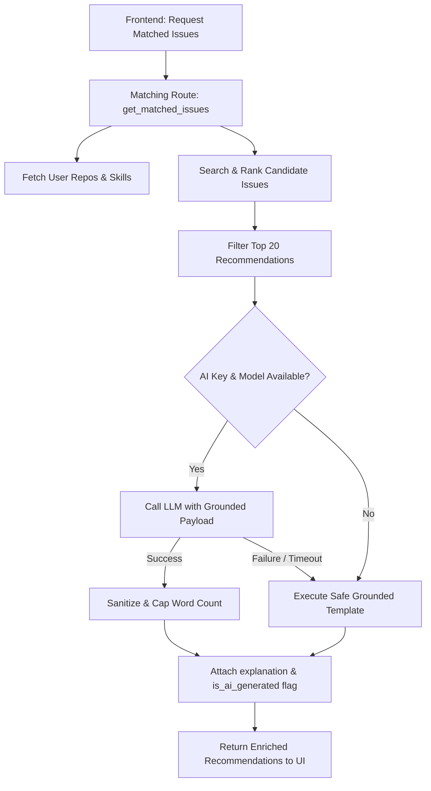

# "Why This Issue Matches You" Explanation System & Safe Fallbacks

**Issue Reference:** #28  
**Components:**
- `backend/app/ai/ai_service.py`
- `backend/app/api/routes/matching.py`
- `backend/tests/test_ai_explanations.py`
- `frontend/app/page.tsx`

---

## 1. Overview & Problem Statement

Issue recommendations ranked by compatibility scores give developers numeric confidence, but developers still face friction understanding *why* a particular issue is well-suited for their skills without manually reviewing entire issue descriptions and repo guidelines.

This feature delivers grounded, human-readable explanations answering **"Why this issue matches you"**:
- **With LLM Configured (`AI_API_KEY`):** Produces tailored, contextual explanations synthesized strictly from retrieved GitHub data and detected developer skills.
- **Without LLM Configured (or on API error):** Automatically produces deterministic, high-quality template explanations derived from language matches, repository signals, and issue labels.
- **Strict Anti-Hallucination Guardrails:** The LLM receives strictly retrieved metadata (title, repo, language, labels, comments).
- **Security Guarantee:** API keys are never logged, persisted, or returned in error payloads.

---

## 2. Architecture & Request Pipeline

---

## 3. Anti-Hallucination & Prompt Guardrails

1. **Retrieved-Data Constraint:**
   The prompt payload contains strictly retrieved GitHub attributes:
   - `repository`: Repository owner and name
   - `title`: Actual issue title
   - `language`: Detected primary repository language
   - `labels`: Top labels (e.g. `good first issue`, `help wanted`)
   - `comments`: Discussion count
   - `user_skills`: Top developer detected technologies
2. **System Instruction:**
   Explicit system prompt forbidding the model from assuming or inventing unlisted dependencies, architectural patterns, or repo rules.
3. **Strict Length & Token Capping:**
   Hard-capped at 100 max tokens and a strict post-processing limit of 50 words (`osm_max_explanation_words`). If an LLM response exceeds the threshold, it is cleanly truncated with an ellipsis.

---

## 4. Deterministic Grounded Template Engine

When no API key is provided, `build_template_explanation(issue, user_skills)` constructs a natural-language summary by analyzing key signals:

| Signal Detected | Template Segment Produced |
| :--- | :--- |
| **Language match** | `"directly leverages your experience with {skills}"` |
| **Title skill match** | Matches keywords like Docker, React, etc. from title words |
| **"good first issue"** | `"is curated as a beginner-friendly 'good first issue'"` |
| **"help wanted"** | `"is actively seeking community contributors"` |
| **Zero comments** | `"has no discussion yet, giving you a fresh opportunity to contribute"` |
| **Low comments (< 4)** | `"has active discussion ({N} comments) with room to collaborate"` |

---

## 5. Security & Zero Key Leakage Verification

- `AISettings` ignores extra environment fields and protects sensitive values.
- `generate_issue_match_explanation` catches all exceptions (`Exception`) and falls back silently to template explanations without dumping tracebacks or authorization headers.
- Tested in `backend/tests/test_ai_explanations.py::test_security_api_keys_never_leaked_in_output` to verify secret keys never appear in output strings or exception representations.

---

## 6. UI Presentation

In `frontend/app/page.tsx`:
- The issue card renders a dedicated callout banner:
  - If `is_ai_generated === true`: Displays `✦ AI Match Grounding` with an `AI Guided` pill badge.
  - If template-generated: Displays `🎯 Why this issue matches you`.
- Explanations are styled with high-contrast text and responsive layout across mobile and desktop.
