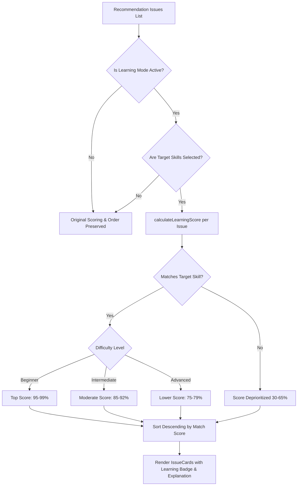

# Learning Mode Feature Documentation

## Overview

Open-source issue recommendation engines typically bias toward skills a developer already uses heavily. While helpful for contributing within comfort zones, this creates friction for students and engineers wanting to learn a new language or framework (e.g., a TypeScript engineer branching into Rust or Go).

**Learning Mode** provides an interactive toggle and target skills picker that dynamically re-ranks recommendations to prioritize **beginner-friendly** issues in the selected technologies, with transparent card-level explanations.

---

## Key Features

1. **Learning Mode Toggle**:
   - Easily accessible switch above the recommendation filters.
   - When **off** (default): recommendation ranking and match scores remain strictly unchanged.
   - When **on**: reveals the interactive target skills picker and re-ranks issues.

2. **Target Skills Picker**:
   - Quick-select interactive chips populated from popular companion technologies (`Python`, `Rust`, `Go`, `TypeScript`, `React`, `CSS`) and any languages dynamically present in the repository index.
   - Supports selecting one or multiple target skills.
   - One-click "Clear target skills" action.

3. **Difficulty-Aware Scoring & Ranking**:
   - Uses the existing difficulty estimation (`inferIssueDifficulty` and `issue.difficulty`).
   - Issues matching chosen target skills are prioritized:
     - **Beginner**: Scored highest (95–99%), placing starter issues at the top of the feed.
     - **Intermediate**: Scored moderately (85–92%).
     - **Advanced**: Scored lower (70–79%), ensuring complex architecture tasks do not overwhelm new learners.
   - Non-target issues are deprioritized so the chosen skills remain in focus.

4. **Transparent Explanations on Each Card**:
   - Visual indicator badge: `🌱 Learning: [Target Skill]`.
   - Distinct green-accented explanation block: `Why this is recommended for you (Learning Mode)`.
   - Clear rationale describing why the issue was picked for skill growth (e.g., *"Picked for Learning Mode: beginner-friendly starter issue to help you learn and grow into Rust."*).
   - Match reason checklist entries highlighting the target skill and beginner difficulty.

---

## Architecture & Scoring Rules

### Deterministic Scoring Formulas

| Match Type | Difficulty | Score Range | Learning Mode Card Explanation |
| :--- | :--- | :--- | :--- |
| **Target Skill Match** | **Beginner** | **95–99%** | *"Picked for Learning Mode: beginner-friendly starter issue to help you learn and grow into {skill}."* |
| **Target Skill Match** | **Intermediate** | **85–92%** | *"Picked for Learning Mode: intermediate {skill} issue to build your hands-on experience."* |
| **Target Skill Match** | **Advanced** | **70–79%** | *"Picked for Learning Mode: advanced {skill} issue for deeper mastery."* |
| **Non-target Skill** | Any | **30–65%** | Original explanation preserved. |

---

## Acceptance Criteria Verification

- [x] **With learning mode on, results favour the chosen skills**: Verified in `learningMode.test.ts` and `RecommendedIssuesList.test.tsx`.
- [x] **Beginner-friendly issues in chosen skills rank higher**: Confirmed through boundary tests in `learningMode.test.ts`.
- [x] **With learning mode off, ranking is unchanged**: Verified in `learningMode.test.ts` and `mockIssues.test.ts`.
- [x] **Explain on each card why it was picked**: Verified via `IssueCard.test.tsx` and `learningMode.test.ts`.
- [x] **Covered by unit tests for the scoring change**: Comprehensive test suite in `frontend/__tests__/learningMode.test.ts`.
