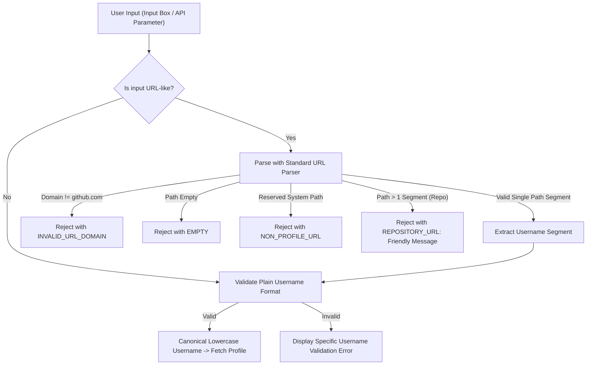

# GitHub Profile URL Parsing & Input Validation

## Overview
Users frequently copy and paste full profile URLs from their browser (such as `github.com/torvalds`, `https://github.com/torvalds/`, or `www.github.com/torvalds`) directly into OpenSourceMate's analyzer input instead of typing only the plain username. Previously, this caused strict username validation to fail due to slashes, dots, and protocols.

This feature enables intelligent parsing of GitHub profile URLs while:
1. Extracting the canonical developer username from various valid GitHub profile URL structures.
2. Rejecting repository URLs (e.g., `github.com/torvalds/linux`) with a clear, friendly error message explaining that a user profile is required.
3. Rejecting non-profile or reserved system paths on GitHub (e.g., `/settings`, `/explore`, `/features`).
4. Rejecting URLs targeting non-GitHub domains.
5. Strictly preserving existing GitHub username validation rules for plain inputs.

---

## Supported Input Formats

### 1. GitHub Profile URLs (Auto-extracted)
All of the following variations successfully extract `torvalds` and trigger profile analysis:
- `github.com/torvalds`
- `https://github.com/torvalds/`
- `http://github.com/torvalds`
- `www.github.com/torvalds`
- `https://www.github.com/torvalds/`
- `http://www.github.com/torvalds/`
- `https://github.com/torvalds?tab=repositories` (Query parameters ignored)
- `https://github.com/torvalds#readme` (Anchor hashes ignored)
- `   https://github.com/torvalds/   ` (Outer whitespace trimmed)

### 2. Plain Usernames (Preserved)
- `torvalds` -> `torvalds`
- `@torvalds` -> `torvalds`
- Standard GitHub formatting: 1-39 alphanumeric characters, single internal hyphens, case-insensitive normalization.

---

## Validation & Error Handling

| Input Example | Status | Error Code | User Message |
| :--- | :--- | :--- | :--- |
| `github.com/torvalds` | Valid | - | Analyzes `torvalds` |
| `https://github.com/torvalds/` | Valid | - | Analyzes `torvalds` |
| `www.github.com/torvalds` | Valid | - | Analyzes `torvalds` |
| `github.com/torvalds/linux` | Invalid | `REPOSITORY_URL` | *"Please enter a user profile URL, not a repository URL (e.g. 'github.com/torvalds')."* |
| `https://github.com/settings` | Invalid | `NON_PROFILE_URL` | *"The URL path '/settings' is a reserved GitHub page, not a user profile."* |
| `https://gitlab.com/torvalds` | Invalid | `INVALID_URL_DOMAIN` | *"Only GitHub profile URLs (github.com/<username>) are supported."* |
| `https://github.com` | Invalid | `EMPTY` | *"Please enter a GitHub username or profile URL."* |
| `-invaliduser` | Invalid | `STARTS_WITH_HYPHEN` | *"GitHub username cannot begin with a hyphen ('-')."* |
| `user--name` | Invalid | `CONSECUTIVE_HYPHENS` | *"GitHub username cannot contain multiple consecutive hyphens ('--')."* |

---

## Flow Architecture

---

## Acceptance Criteria Checklist
- [x] `github.com/torvalds`, `https://github.com/torvalds/` and `www.github.com/torvalds` all analyze `torvalds`
- [x] A repository URL shows a friendly error
- [x] Covered by unit tests for the parser
- [x] Existing plain username validation rules preserved
