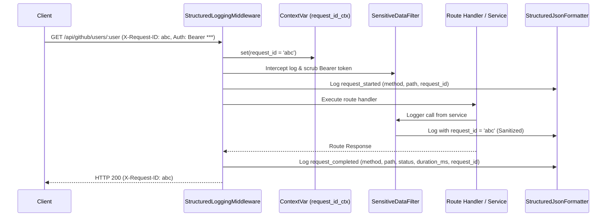

# Structured Logging, Request IDs & Health Monitoring

## Overview

Structured logging, request ID tracking, and operational health endpoints provide comprehensive backend observability, correlation across distributed operations, and audit trails while strictly safeguarding credentials and tokens from log leakage.

## Key Capabilities

1. **Operational Health & Liveness Endpoints (`/health`, `/api/health`, `/api/v1/health`)**:
   - Responds immediately with `{"status": "healthy", "service": "OpenSourceMate API", "version": "0.1.0", "uptime": <seconds>}`.
   - Calculates uptime since backend process startup without issuing any downstream calls to external APIs or GitHub.
   - Ideal for Kubernetes liveness probes, load balancer health checks, and process monitoring.

2. **Request ID Lifecycle & Context Propagation (`X-Request-ID`)**:
   - Every incoming request is tagged with an `X-Request-ID`.
   - If provided by client, the ID is validated and preserved. Otherwise, a secure UUID4 is generated.
   - Propagated across asynchronous tasks using Python's `contextvars.ContextVar` (`request_id_ctx`).
   - Attached to outgoing HTTP response headers (`X-Request-ID`) for end-to-end client-server tracing.
   - `SensitiveDataFilter` automatically injects `record.request_id` onto every log line emitted during a request.

3. **Request Lifecycle Logging**:
   - Emits structured log events for incoming requests and completions recording:
     - `method` (HTTP method: GET, POST, etc.)
     - `path` (URL path: `/health`, `/api/github/...`)
     - `status` (HTTP status code: 200, 404, 500, etc.)
     - `duration` (latency in milliseconds)
     - `request_id` (contextual correlation identifier)

4. **Secrets Sanitization & Token Masking**:
   - `SensitiveDataFilter` and `sanitize_sensitive_data()` automatically intercept and scrub:
     - Sensitive keys in dictionaries: `authorization`, `token`, `github_token`, `access_token`, `refresh_token`, `secret`, `secret_key`, `password`, `api_key`, `ai_api_key`, `cookie`, `session`.
     - Authentication headers: `Bearer <token>`, `Basic <credentials>`.
     - Token patterns in text: `ghp_*`, `gho_*`, `ghu_*`, `ghs_*`, `github_pat_*`, `sk-*`.
     - Sensitive query string parameters (`?token=...`, `?access_token=...`).

5. **Configurable Log Level**:
   - Log level is fully configurable through the `LOG_LEVEL` environment variable (e.g. `DEBUG`, `INFO`, `WARNING`, `ERROR`, `CRITICAL`), defaulting to `INFO`.
   - Validated through Pydantic settings with case-insensitive parsing.

## Architecture

